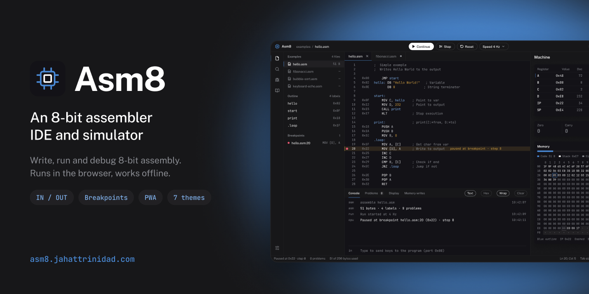
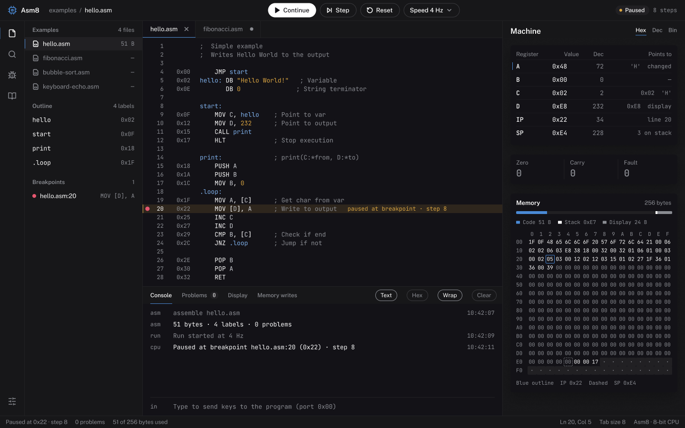
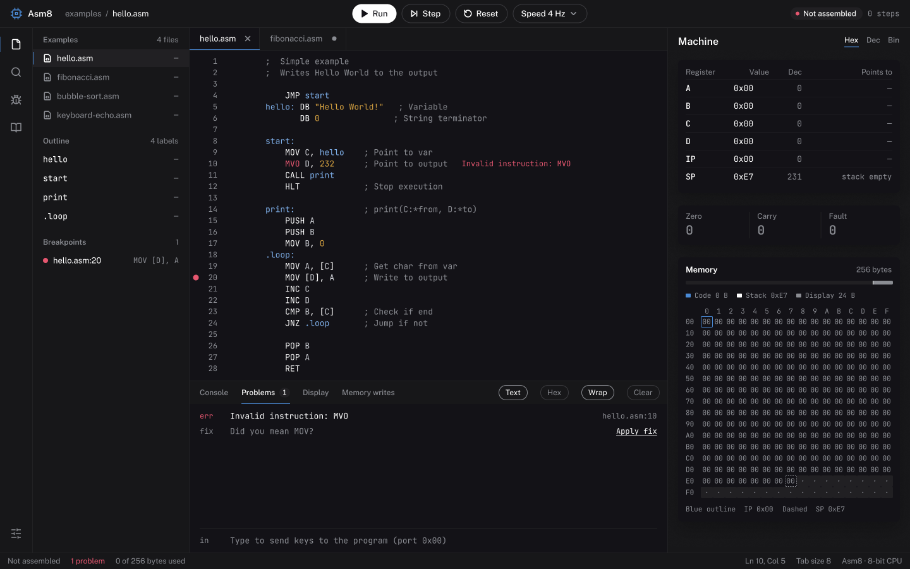
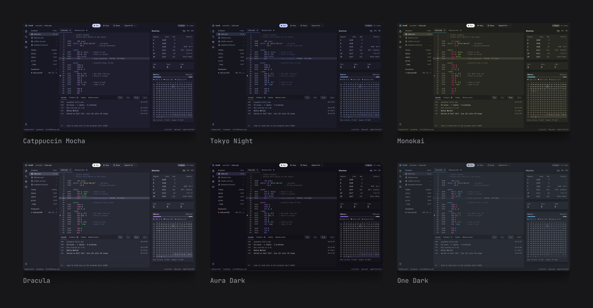
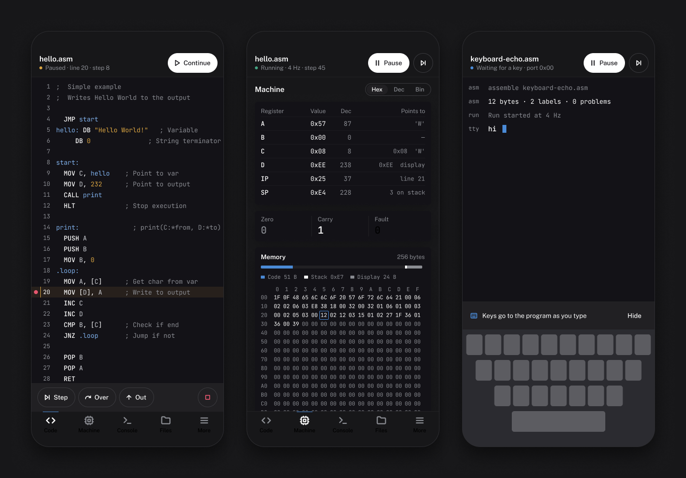

<p align="center">
  <a href="https://asm8.jahattrinidad.com/">
    
  </a>
</p>

<p align="center">
  <a href="https://asm8.jahattrinidad.com/"><strong>Open Asm8 →</strong></a>
  &nbsp;·&nbsp;
  <a href="#features">Features</a>
  &nbsp;·&nbsp;
  <a href="#run-it-locally">Run it locally</a>
  &nbsp;·&nbsp;
  <a href="#architecture">Architecture</a>
</p>

<p align="center">
  <a href="https://github.com/trinity-bytes/assembler-simulator/actions/workflows/deploy.yml"></a>
  
  
  
  
</p>

**Asm8** is an 8-bit assembler IDE and simulator that runs in the browser and installs as an app.
Write assembly in a real code editor, run it at the speed you want, stop at a breakpoint and watch
every register, flag and memory cell change.

It is a modern rewrite of [Simple 8-bit Assembler Simulator](https://github.com/Schweigi/assembler-simulator)
by Marco Schweighauser (MIT). The original app lives in `legacy/` and the parity tests run against it.

<p align="center">
  
</p>

## Features

### ✍️ An editor that knows assembly

CodeMirror 6 with syntax colours and the byte address of every line. Every problem is underlined at
once, with quick fixes. Hover an instruction for its docs, a label for its address, or a register
for its live value. Autocomplete for instructions, registers and labels.

<p align="center">
  
</p>

### 🐞 A debugger, not just a Run button

- Run at **1, 4, 16 or 64 Hz** or **Max**. The CPU runs in a Web Worker, so the page never freezes.
- **Step**, step over a `CALL`, step out.
- **Breakpoints** in the gutter, with conditions (`A == 'H'`, `[D] != 0`) and hit counts.
- **Watch expressions**, a **call stack** read from the stack, and **Reset with Undo**.

### 🧠 The whole machine in view

Registers in hex, decimal or binary, with "changed" marks. Flags. The stack, showing who pushed each
byte. The 256-byte memory map (edit a cell while paused), the 24-byte display, and a log of every
memory write.

### ⌨️ New instructions: keyboard in, text out

| Instruction | Opcode | Meaning                                                                  |
| ----------- | ------ | ------------------------------------------------------------------------ |
| `IN reg`    | 98     | Waits for a key typed in the console and stores its code in the register |
| `OUT reg`   | 99     | Prints the register as a character in the console                        |

```asm
; Keyboard echo: every key you type is printed back. Enter stops.
loop:
        IN A            ; wait for a key
        CMP A, 10       ; Enter?
        JZ done
        OUT A           ; print it
        JMP loop
done:
        HLT
```

The console has no line limit and shows program output, keyboard input and errors.
Differences from the original simulator are listed in [docs/parity.md](docs/parity.md).

### 📁 Your files, your folder

Open a real folder (Chromium desktop, File System Access) or use the browser workspace (every
browser, OPFS). New, rename, duplicate, delete with confirmation, unsaved-changes prompts,
"changed on disk" detection, download and import. Four example programs are built in.

### 🎨 Seven themes

Asm8 Dark (meets WCAG contrast), Catppuccin Mocha, Tokyo Night, Monokai, Dracula, Aura Dark and One Dark.

<p align="center">
  
</p>

### 📱 Desktop, tablet and phone. Online or offline.

An installable PWA that works offline. Installed on desktop Chromium, `.asm` files open in Asm8
straight from the file manager. Tablet and phone get their own layouts.

<p align="center">
  
</p>

## Run it locally

You need Node.js 20.19+ or 22.12+.

```sh
git clone https://github.com/trinity-bytes/assembler-simulator.git
cd assembler-simulator
npm install
npm run dev
```

| Command                   | What it does                                                      |
| ------------------------- | ----------------------------------------------------------------- |
| `npm run dev`             | Dev server                                                        |
| `npm run build`           | Production build (PWA) in `dist/`                                 |
| `npm run preview`         | Serves the production build                                       |
| `npm test`                | Unit tests (Vitest)                                               |
| `npm run check`           | Type check (`svelte-check`)                                       |
| `npm run lint`            | ESLint                                                            |
| `npm run e2e`             | Builds, then runs the end-to-end tests (Playwright, Chromium)     |
| `node scripts/tokens.mjs` | Regenerates `src/ui/theme/tokens.css` from the Figma token export |

### Deployment

Every push to `master` runs the tests, builds and publishes `dist/` to GitHub Pages
([`.github/workflows/deploy.yml`](.github/workflows/deploy.yml)), served at
[asm8.jahattrinidad.com](https://asm8.jahattrinidad.com/). The workflow can also be run by hand from
the Actions tab.

## Architecture

Hexagonal: dependencies point inward, the core knows nothing about the browser.

```
src/
  core/          Pure domain: instruction set, assembler, CPU, debugger rules. No DOM, no Svelte.
  application/   Use cases and ports (interfaces) the UI talks to: workspace, run session, settings.
  adapters/      Port implementations: File System Access, OPFS, IndexedDB, Web Worker runner, PWA.
  ui/            Svelte 5. atoms → molecules → organisms → screens; `state/` holds the containers,
                 `editor/` the CodeMirror integration, `theme/` the tokens. `App.svelte` is the
                 composition root (the only place that picks adapters).
```

Flow of a run: the UI calls `SessionState.run()` → it assembles with the core and sends commands
through the `RunnerPort` → the Web Worker hosts `RunLoop` (application), which drives the core
`Machine` + `Debugger` on a clock and posts snapshots back (every step, or every 100 ms at Max).

ESLint enforces the direction: `core` cannot import `application`, `adapters`, `ui` or Svelte;
`application` cannot import `adapters` or `ui`.

## Credits

- Original simulator: [Simple 8-bit Assembler Simulator](https://github.com/Schweigi/assembler-simulator)
  by Marco Schweighauser, MIT license.
- Interface designed in Figma; the screenshots in this README are exported from that file.
